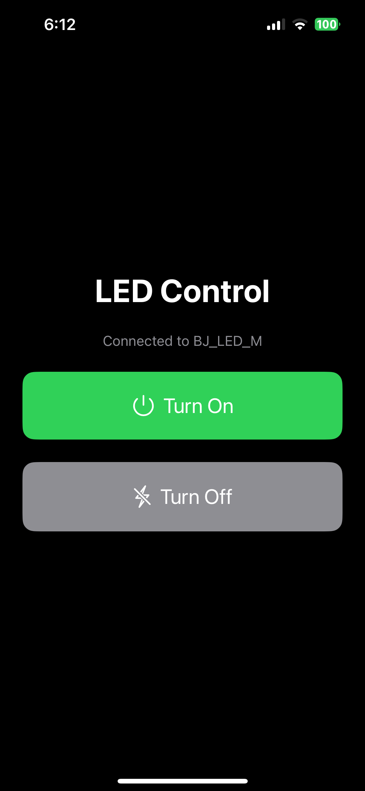
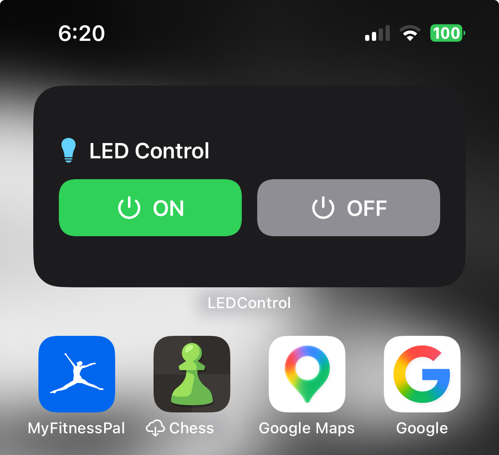

# Bluetooth Controller for my Room LED Lights:
## App (LEDControl)
A simple iOS app built with SwiftUI and CoreBluetooth to turn my LED lights on and off over Bluetooth Low Energy (BLE). Connects directly to the LED controller and sends commands through GATT. Includes a Home Screen widget for quick access.

<table>
  <tr>
    <th align="center">Working Demo</th>
    <th align="center">iOS App</th>
    <th align="center">Home Screen Widget</th>
  </tr>
  <tr>
    <td align="center" width="45%">
      <video src="https://github.com/user-attachments/assets/81956ac3-81e9-47f1-9fa9-5a88fa3d3fa1" controls></video>
    </td>
    <td align="center" width="30%">
      
    </td>
    <td align="center" width="30%">
      
    </td>
  </tr>
</table>

## POC Findings:
- Uses BLE
- Discovered a vendor-specific GATT service (EEA0) with two characteristics: EE01 and EE02.
- EE01 advertises notifications, but subscribing fails. Its notification configuration descriptor (0x2902) was not discovered
- Found ON/OFF commands sent to EE02
    - ON:	`69 96 06 01 01`
    - OFF:	`69 96 02 01 00`

### Notes:
- Using the python script I was able to find:
    - `D16769BD-9A8F-D578-8560-A91AB4FDD99A` is the bluetooth identifier
    - Its called `BJ_LED_M`
    - The strength is about `-64 dBm`

- It is a BLE => Bluetooth Low Energy device

#### What is a Service:
- A BLE service is a logical grouping of a related functionality.
- The LED exposes => `0000eea0-0000-1000-8000-00805f9b34fb`
    - `EEA0`

#### What is a Characteristic:
- The data endpoint associated with a service.
- The LED service (`EEA0`) has two `EE01` - {Read, Notify, Write without response} and `EE02` - {Read, Write, Write without response}
- Define how we can exchange data with the device, but not what the data actually means

#### Characteristic Properties:
- What do each of the properties for a characteristic mean?
- The following are Bluetooth GATT specs.
1. `read` -> We can request teh characteristics current value
2. `write` -> We can write data and receive a BLE level response
3. `write-without-response` -> We can submit data without waiting for the BLE level ACK
4. `notify` -> The device can send updated values to us when notifications enabled.

#### Determining how to communicate with the BTE device;
- We need to determine what the bytes mean -> we need to determine the encoding to communicate with the BLE device.

Running an experiment using `bt_probe.py`
1. Having the lights on then running
2. Having the lights off then running

- Notifications failed; the script crashed but:
    - Both Characteristics returned 
        `00 01 02 03 04 05 06 07 08 09 0a 0b 0c 0d 0e 0f 00 00 00 00`

- [8non1/BJ_LED](https://github.com/8none1/BJ_LED) referenced commands for turning on and off. 
    - ON:	`69 96 06 01 01`
    - OFF:	`69 96 02 01 00`
    - I tested this on my LED device and they worked!! 

- Trying to decode the hex byte encoding:
    - `69 96 06 01 01` < header > < header > <?> <?> < value? >
